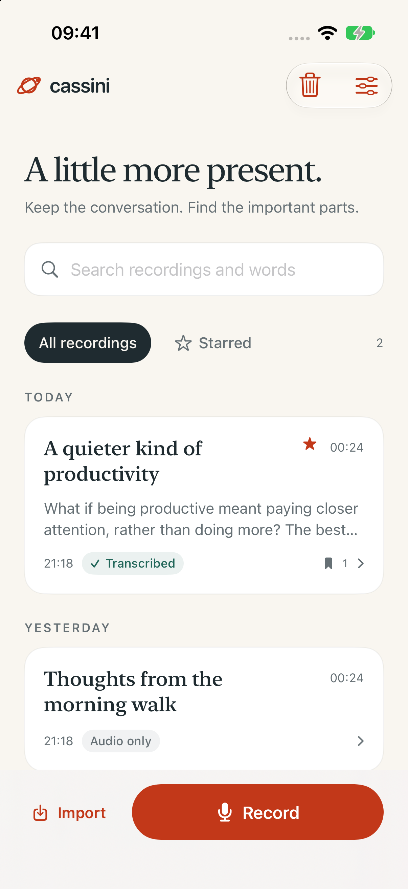
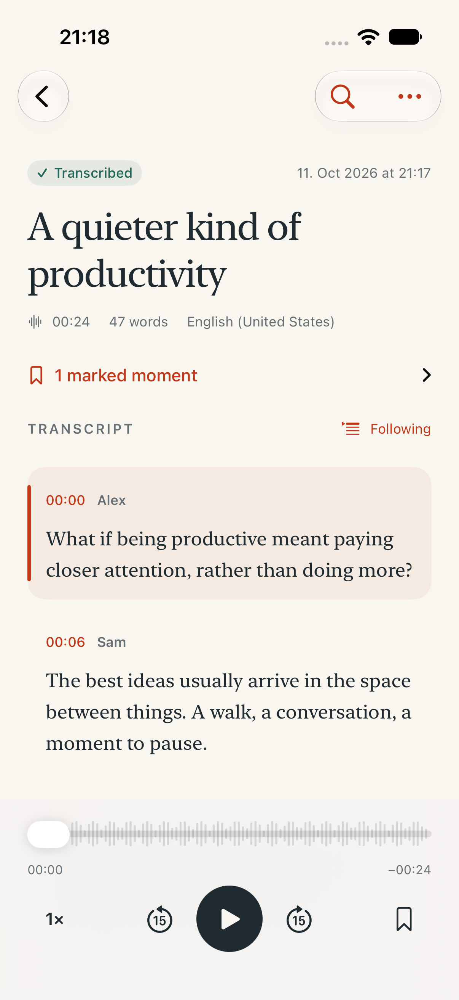
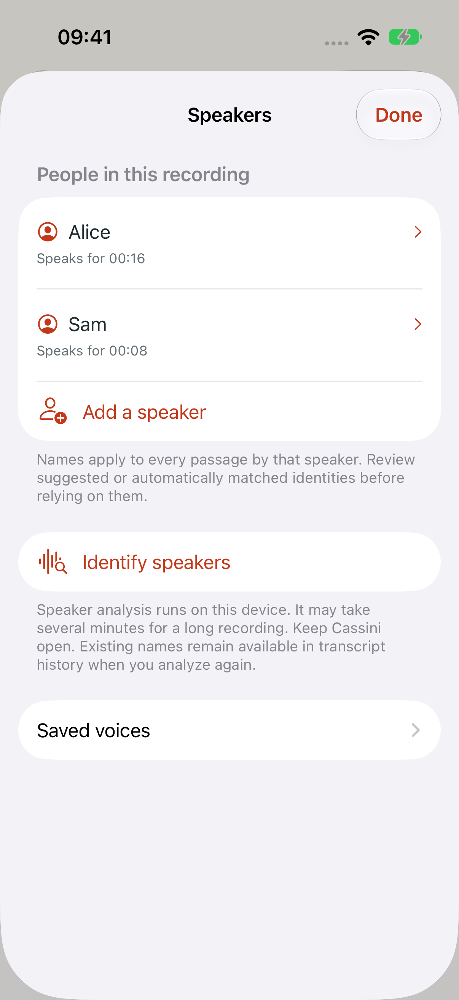

# Cassini for iOS

A private audio notebook for recording, transcribing, and returning to conversations. Native SwiftUI for iPhone and iPad, targeting iOS 26 or later. This is a new implementation informed by the product behavior of [Cassini Android’s rebuild](https://github.com/codemyriad/cassini-android/tree/rebuild).

## Run

Generate the project with the commands below, then open `Cassini.xcodeproj`, select the **Cassini** scheme, and run on an iPhone or iPad. For a physical device, select your development team under Signing & Capabilities. Xcode 26 or newer is required; this project has been built with Xcode 27.

The generated Xcode project is intentionally excluded from source control. Generate it after checkout and after changing target configuration or adding files:

```sh
brew install xcodegen
xcodegen generate
```

No API keys, accounts, or audio-processing backend are required. Pinned Swift packages provide on-device Core ML diarization (FluidAudio) and the Opus codec (swift-opus/libopus). `Package.resolved` records the exact revisions. Swift 6.2 or newer is required.

## What works

- Record with pause/resume, a real microphone waveform, editable titles, and time bookmarks. Recording continues with the screen locked. Calls and disconnected audio inputs pause capture explicitly.
- Capture into recoverable 48 kHz PCM CAF, then compress to M4A after saving. If compression fails, the original remains playable. Low-storage checks protect capture; errors preserve existing audio.
- Import system-supported audio through Files or “Open in Cassini”; recordings are copied into protected local storage.
- Transcribe with Apple `SpeechAnalyzer` / `SpeechTranscriber`, including language selection, explicit model-download consent, a serial queue, cancellation, and retry. There is no server transcription fallback.
- Search titles, transcripts, and bookmarks without case or accent sensitivity; star recordings for quick access.
- Read along with playback, tap timed words to seek, adjust speed, skip ±15 seconds, and use lock-screen playback controls. Playback position survives relaunch.
- Identify speakers on-device using the offline pyannote community-1 / WeSpeaker / VBx Core ML pipeline. Assign timed words to speaker turns, including overlapping turns, without inventing word timings.
- Rename a speaker across all their passages, reassign a passage, play a speaker sample, and merge duplicate speakers. Merges and re-analysis keep earlier transcript versions.
- Remember a voice explicitly, suggest matching people in later recordings, rename or forget saved voices, erase all voice data, and reject incorrect matches. Optional automatic naming uses a conservative score and rival margin; it is off by default. Only explicitly confirmed samples train a saved profile.
- Edit passages. Editing words discards stale word timing for that passage while preserving its audio range. Select earlier or imported transcript versions from the recording menu.
- Import and play mono/stereo Ogg Opus using a bundled decoder. Keep the original document unchanged while using a local PCM playback copy.
- Export text, SRT, WebVTT, structured JSON, original audio, or a portable Cassini `.opus` document. Portable exports preserve the source’s verified variants and audio packets, append local transcript versions, and carry edited speaker names. New iOS recordings are encoded to Opus for portable export.
- Restore from Recently Deleted, delete an individual recording, or confirm Empty trash. Retention is 30 calendar days; expiry runs on app activation and opening trash. Permanent deletion also removes that recording’s voice samples.
- Light/dark appearance, Dynamic Type, VoiceOver controls, and layouts for iPhone and iPad.

## Current boundaries

This is a working first iOS implementation, not an App Store release or complete Android parity.

- Android uses Sortformer/CAM++ and Parakeet; iOS uses Core ML offline diarization and Apple Speech. Feature availability does not imply equal recognition accuracy. Android CAM++ voiceprints are not compatible with iOS embeddings and are never imported.
- Voice matching requires at least six seconds of isolated speech and the same embedding-model fingerprint. Suggestions are the default. Optional automatic naming has conservative thresholds but has not been calibrated on a representative iPhone recording corpus; review the names.
- Opus playback supports standard mono/stereo channel mapping 0. Unsupported multichannel documents retain their readable verified transcript and original file with a playback explanation.
- Transcription availability depends on Apple’s supported hardware and languages. A real supported device is required to validate recognition accuracy, model downloads, thermal behavior, Bluetooth routes, and long background capture. Simulator fixtures do not establish recognition quality.
- Recording/playback can continue in the background; transcription gets only the finite background time iOS grants. On suspension it preserves the audio and asks the user to retry. It does not claim unlimited background inference or resumable inference checkpoints.
- Interrupted recording recovery is best effort. A severely damaged or empty source is preserved and flagged, never silently discarded.
- Speech models are managed by iOS. Model installation currently shows an indeterminate preparation state; transcript progress is based on finalized audio timestamps.
- System backups may include recordings and transcripts. Voiceprints and downloaded speaker models are excluded from backups. No app-managed cloud sync, analytics, or audio upload is implemented. Apple and Hugging Face model downloads require separate consent.

## Verify

```sh
scripts/test.sh fast     # the Swift package tests (swift test)
scripts/test.sh app      # build for testing, then the hosted unit tests (CassiniTests)
scripts/test.sh ui       # build for testing, then the UI tests across simulator clones
scripts/test.sh all      # all three (swift test beside the build); prints the time of each step
scripts/test.sh changed  # only what the changes since main touch (or since a base: changed <ref>)
scripts/test.sh clean    # delete this worktree's simulator clones
```

The script builds once and runs the tests from that build. It keeps its simulator clones (`ts-<worktree>-iphone-N`, and an iPad for the `testIPad*` tests, or for all of them with `CASSINI_UI_IPAD=all`) booted for the next run and splits the UI tests across up to three of them, fewer when memory is short (`CASSINI_UI_WORKERS` sets the number), balanced by each test's last measured time. Booted clones of other worktrees that no xcodebuild has used for 15 minutes are shut down (not deleted) first. A test run that has not started a test after a minute and a half (hosted) or three minutes (UI), or whose runner failed to launch, is tried once more. Builds stay in the worktree's `DerivedData.noindex` (`DerivedData` links to it), which Spotlight skips; package checkouts are shared between worktrees in `.test-cache` beside the main checkout. Arguments after the tier go to xcodebuild, for example `scripts/test.sh ui -only-testing:CassiniUITests/NoteScreenTests`, which shards that class. `scripts/test-remote.sh [tier]` runs a tier on the Mac named by `CASSINI_MAC`.

On an idle 10-core Mac a warm `scripts/test.sh all` takes about two and a half minutes with three shards and about four and a half with one.

The original `CassiniCore` format library and its conformance tests are preserved. The zlib shim is a normal C target so Xcode can link shared package products into the hosted test bundle. Set `CASSINI_CONFORMANCE` to a cassini-format checkout’s `spec/conformance` directory and `CASSINI_CONFORMANCE_REQUIRED=1` to require those vectors. `CassiniNotebook` adds the app model and verified transcript import. The notebook suite checks metadata persistence and corruption isolation, path safety, search, and subtitle boundaries. The iOS integration suite checks real CAF inspection, AAC/M4A conversion, import integrity, malformed audio rejection, and recovery. UI tests exercise empty/library states, search, playback, renaming and relaunch persistence, download consent, and trash/restore. The capture test exercises pause/resume/save when an input is available, or verifies recovery from a clear missing-input error on headless hosts. Grant microphone access to the test simulator before recording tests if needed:

```sh
xcrun simctl privacy booted grant microphone app.codemyriad.cassini
```

UI tests use a separate library and explicitly seeded silent audio fixtures. A normal launch starts empty. Test fixtures are compiled only in Debug.

Unlike Android, where each Compose test sets up its own content, a new app process costs XCTest about five seconds, so most UI tests do not start one: `launchAndWait()` opens `cassini://ui-test/relaunch`, and a Debug process launched with `--ui-testing` replaces its app graph with one built from the new arguments over a fresh library and preferences (`UITestRelaunch`). A runner's first test, a test after a failure, a relaunch that keeps the data to check persistence, and a launch with other system arguments (such as the text size) still start a new process.

See [validation](docs/validation.md) for test evidence and remaining device checks, and [architecture](docs/architecture.md) for storage and lifecycle details.

## Preview

Simulator screenshots use explicitly seeded test transcripts and silent audio; they are UI examples, not recognition results.

| iPhone library | iPhone transcript | Speakers |
|---|---|---|
|  |  |  |

[iPad dark-mode preview](docs/screenshots/ipad-transcript-dark.png)
