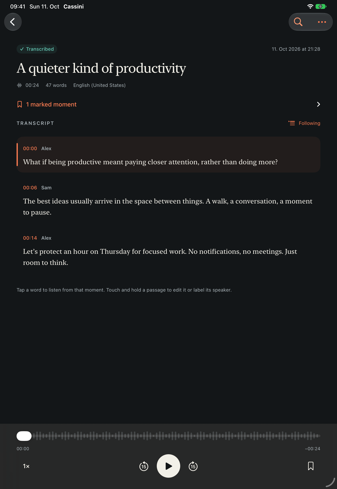

# Cassini for iOS

A private audio notebook for recording, transcribing, and returning to conversations. Native SwiftUI for iPhone and iPad, targeting iOS 26 or later. This is a new implementation informed by the product behavior of [Cassini Android’s rebuild](https://github.com/codemyriad/cassini-android/tree/rebuild).

## Run

Generate the project with the commands below, then open `Cassini.xcodeproj`, select the **Cassini** scheme, and run on an iPhone or iPad. For a physical device, select your development team under Signing & Capabilities. Xcode 26 or newer is required; this project has been built with Xcode 27.

The generated Xcode project is intentionally excluded from source control. Generate it after checkout and after changing target configuration or adding files:

```sh
brew install xcodegen
xcodegen generate
```

There are no external package dependencies, API keys, accounts, or backend services.

## What works

- Record with pause/resume, a real microphone waveform, editable titles, and time bookmarks. Recording continues with the screen locked. Calls and disconnected audio inputs pause capture explicitly.
- Capture into recoverable 48 kHz PCM CAF, then compress to M4A after saving. If compression fails, the original remains playable. Low-storage checks protect capture; errors preserve existing audio.
- Import system-supported audio through Files or “Open in Cassini”; recordings are copied into protected local storage.
- Transcribe with Apple `SpeechAnalyzer` / `SpeechTranscriber`, including language selection, explicit model-download consent, a serial queue, cancellation, and retry. There is no server transcription fallback.
- Search titles, transcripts, and bookmarks without case or accent sensitivity; star recordings for quick access.
- Read along with playback, tap timed words to seek, adjust speed, skip ±15 seconds, and use lock-screen playback controls. Playback position survives relaunch.
- Edit passages and manually label speakers. Editing words discards stale word timing for that passage while preserving its audio range.
- Export text, SRT, WebVTT, structured JSON, or original audio through the system share sheet.
- Restore from Recently Deleted, or explicitly confirm permanent deletion.
- Light/dark appearance, Dynamic Type, VoiceOver controls, and layouts for iPhone and iPad.

## Current boundaries

This is a working first iOS implementation, not an App Store release or complete Android parity.

- Automatic speaker diarization and remembered voice identities are not implemented. Speaker labels are manual.
- Verified Cassini `.opus` documents import their default transcript, timing, and speaker labels while retaining the original file and its variants. Playback depends on AVFoundation codec support; when unavailable, the transcript remains readable and the original can still be shared. There is no bundled Opus decoder or encoder. Edits stay in the iOS library; writing those edits back to the portable document and selecting alternate variants are not yet exposed. JSON export is not a replacement for the Cassini format.
- Transcription availability depends on Apple’s supported hardware and languages. A real supported device is required to validate recognition accuracy, model downloads, thermal behavior, Bluetooth routes, and long background capture. Simulator fixtures do not establish recognition quality.
- Recording/playback can continue in the background; transcription gets only the finite background time iOS grants. On suspension it preserves the audio and asks the user to retry. It does not claim unlimited background inference or resumable inference checkpoints.
- Interrupted recording recovery is best effort. A severely damaged or empty source is preserved and flagged, never silently discarded.
- Speech models are managed by iOS. Model installation currently shows an indeterminate preparation state; transcript progress is based on finalized audio timestamps.
- Recently Deleted does not expire automatically. System backups may include the library. There is no app-managed cloud sync, analytics, or outbound audio upload.

## Verify

```sh
swift test
xcodebuild -project Cassini.xcodeproj -scheme Cassini \
  -destination 'generic/platform=iOS Simulator' \
  -derivedDataPath DerivedData CODE_SIGNING_ALLOWED=NO build
xcodebuild -project Cassini.xcodeproj -scheme Cassini \
  -destination 'platform=iOS Simulator,name=iPhone 17' \
  -collect-test-diagnostics never -parallel-testing-enabled NO \
  CODE_SIGNING_ALLOWED=NO test
```

The original `CassiniCore` format library and its conformance tests are preserved. Set `CASSINI_CONFORMANCE` to a cassini-format checkout’s `spec/conformance` directory and `CASSINI_CONFORMANCE_REQUIRED=1` to require those vectors. `CassiniNotebook` adds the app model and verified transcript import. The notebook suite checks metadata persistence and corruption isolation, path safety, search, and subtitle boundaries. The iOS integration suite checks real CAF inspection, AAC/M4A conversion, import integrity, malformed audio rejection, and recovery. UI tests exercise empty/library states, search, playback, renaming and relaunch persistence, download consent, and trash/restore. The capture test exercises pause/resume/save when an input is available, or verifies recovery from a clear missing-input error on headless hosts. Grant microphone access to the test simulator before recording tests if needed:

```sh
xcrun simctl privacy booted grant microphone app.codemyriad.cassini
```

UI tests use a separate library and explicitly seeded silent audio fixtures. A normal launch starts empty. Test fixtures are compiled only in Debug.

See [architecture](docs/architecture.md) for storage and lifecycle details.

## Preview

Simulator screenshots use explicitly seeded test transcripts and silent audio; they are UI examples, not recognition results.

| iPhone library | iPhone transcript | iPad, dark mode |
|---|---|---|
|  |  |  |
